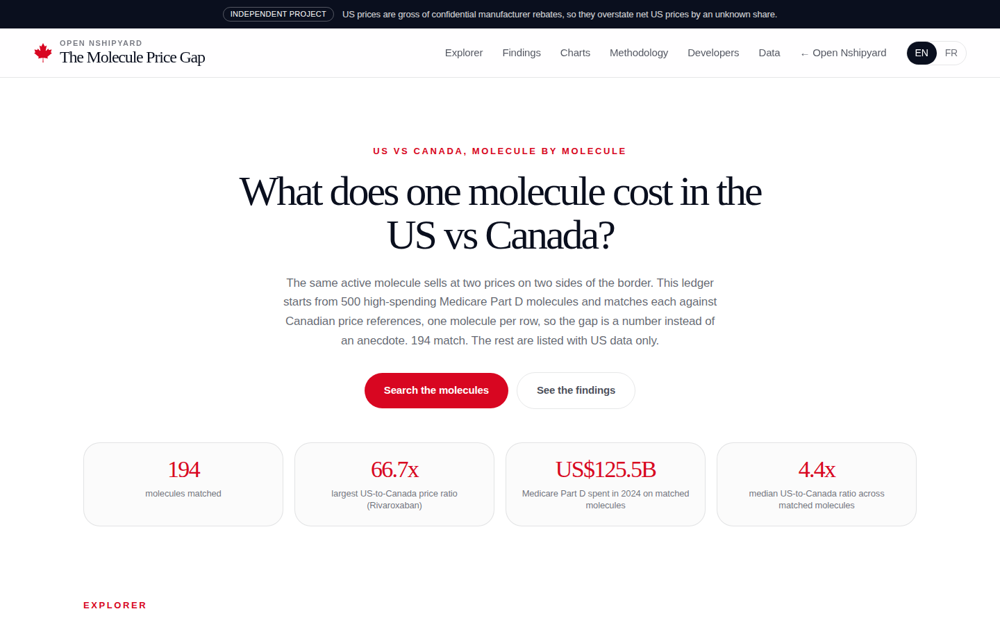
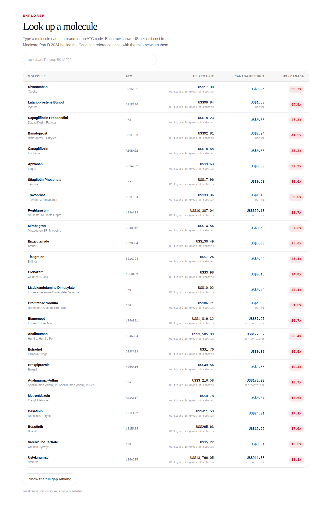
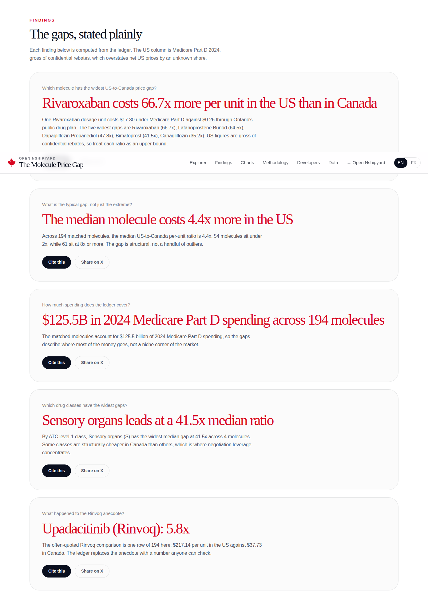
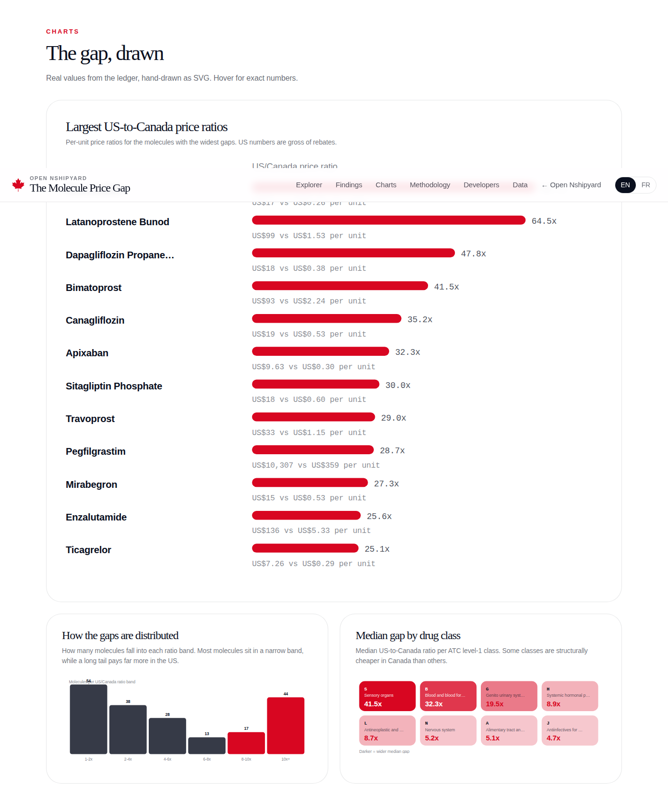
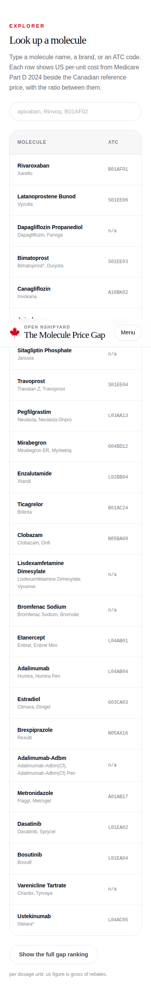

# The Drug Price Gap

What does one molecule cost in the US vs Canada? A molecule-level ledger that
matches high-spending molecules from US Medicare Part D against Canadian
public-plan prices, one molecule per row, so the gap is a number instead of
an anecdote.

An independent open-source project by [Richardson Dackam](https://github.com/richardsondx)
([x.com/richardsondx](https://x.com/richardsondx)), part of
[Open Nshipyard](https://canada.nshipyard.com). Not affiliated with the US
Centers for Medicare & Medicaid Services, the Patented Medicine Prices Review
Board, or any government. MIT licensed.

## The one caveat that matters

US prices are Medicare Part D 2024 amounts **gross of confidential
manufacturer rebates**. CMS is prohibited from disclosing drug-specific
rebates, so the US column overstates net US prices by an unknown share. Treat
every ratio as an upper bound on the true gap.

## Data

- **US**: CMS Medicare Part D Spending by Drug, 2024 release. Only the
  `Overall` manufacturer rollup rows are used (3,625 unique drugs), so no
  dollar is counted twice. Five years of history per row; the ledger uses
  2024.
- **Canada**: Ontario Drug Benefit e-formulary, lowest Drug Benefit Price per
  unit across matched formulary rows (the price Ontario's public plan pays
  pharmacies). Retrieved October 10, 2026. PMPRB publishes no
  machine-readable molecule-level price file, which is why the formulary is
  the Canadian source.
- **Identity**: generic names normalized to molecule keys, resolved to
  RxNorm ingredient RxCUI, ATC codes from RxNorm properties.
- **Currency**: 2024 Bank of Canada daily average, 1 USD = 1.3698 CAD.

## Reproduce the ledger

```bash
python3 scripts/build_molecules_us.py   # CMS -> normalized molecules + RxNorm/ATC
python3 scripts/build_odb_prices.py     # ODB formulary -> Canadian unit prices
python3 scripts/build_final.py          # merge -> data/, public/data/molecule-ledger.csv
```

The raw CMS CSV is downloaded from data.cms.gov at build time and is not
committed. RxNorm results are cached in `data/rxnorm_cache.json`.

## Run the site

```bash
npm install
npm run dev
```

## Use the data

- REST: `/api/v1/summary`, `/api/v1/molecules/search?q=`, `/api/v1/molecules/{key}`,
  `/api/v1/gaps/ranking`, `/api/v1/atc` (spec at `/api/openapi.json`)
- MCP (POST `/mcp`): `molecule_lookup`, `price_gap_ranking`, `atc_breakdown`
- CSV: `/data/molecule-ledger.csv`

## Screenshots







## Author

Built by **Richardson Dackam** · [x.com/richardsondx](https://x.com/richardsondx) ·
[github.com/richardsondx](https://github.com/richardsondx)
